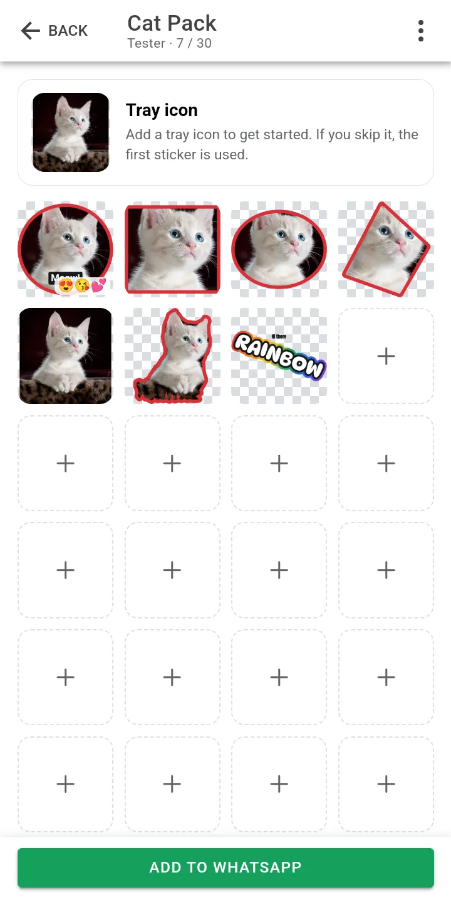
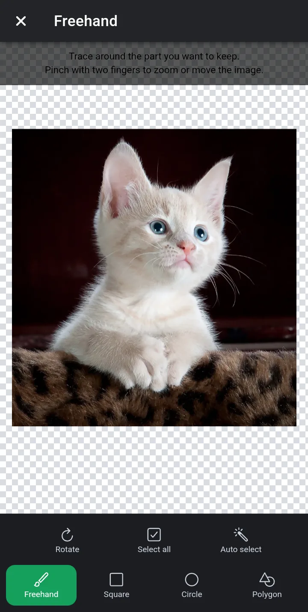
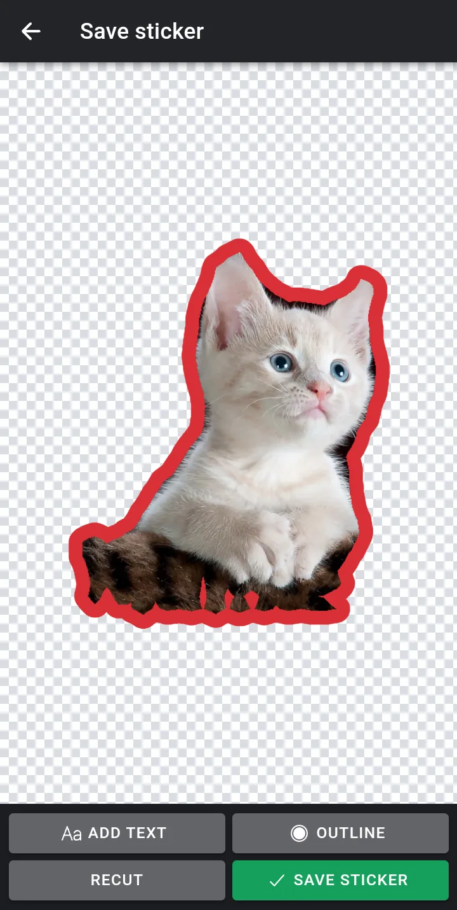
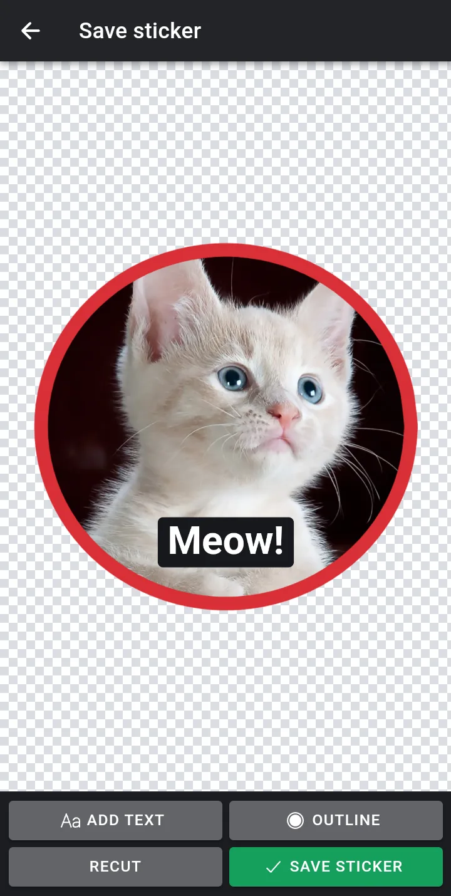

<p align="center">
  
</p>

<h1 align="center">Ppeely</h1>

<p align="center"><b>Peel a sticker out of any photo. Fully offline.</b></p>

<p align="center">
  A WhatsApp sticker maker for Android and iOS: cut out a subject, add an outline and text, and send the pack to WhatsApp.<br>
  Everything is made, stored and encoded on the device.
</p>

<p align="center">
  <a href="../../releases/latest"></a>
  &nbsp;
  
  &nbsp;
  
  &nbsp;
  <a href="../../actions/workflows/ci.yml"></a>
  &nbsp;
  <a href="LICENSE"></a>
</p>

<p align="center">
  <a href="../../releases/latest">⬇️ Download</a>
  ·
  <a href="#-features">Features</a>
  ·
  <a href="#-building">Building</a>
  ·
  <a href="#-testing">Testing</a>
  ·
  <a href="#-releasing">Releasing</a>
  ·
  <a href="README_zh.md">简体中文</a>
</p>

<p align="center">
  
  
  
  
</p>

<table>
<tr>
<td>

**🔒 Offline by design** · Ppeely never uses the network; the Android app doesn't even request the network permission. Photos, stickers and fonts stay on the device: smart select runs a model on the device, and encoding happens in WebAssembly inside the app.

**ℹ️ Not affiliated with WhatsApp** · Ppeely is an independent project and is not affiliated with, endorsed by, or sponsored by WhatsApp or Meta. WhatsApp is a trademark of WhatsApp LLC. The app talks to WhatsApp only through WhatsApp's public third-party sticker protocol.

</td>
</tr>
</table>

---

## ✨ Features

| | Feature | Details |
| :---: | --- | --- |
| 🗂️ | **Sticker packs** | Create, rename, delete and search; up to 30 stickers and a tray icon per pack |
| 🖼️ | **Any source** | Camera, photo library, any file, the sticker library (your existing stickers and those sent and received in WhatsApp), or text only |
| ✂️ | **Cut-out editor** | Freehand, rectangle, ellipse, polygon, select all, rotate, and smart select with an image segmentation model on the device |
| 🖍️ | **Outline and text** | Outline color and width; text layers with fonts, colors and four styles that can be dragged, scaled and rotated |
| 🎞️ | **Animated stickers** | From GIFs, videos or animated WebP, automatically kept under 500 KB |
| 😀 | **Emoji tags** | Up to 3 per sticker, used by WhatsApp's sticker search |
| 💬 | **Add to WhatsApp** | Through a ContentProvider on Android and the pasteboard protocol on iOS |
| 📦 | **Pack files** | Export and import `.wastickers`, including opening them from other apps |
| ⌨️ | **Sticker keyboard** | Android only: send stickers from any chat app through an input method |
| 🌐 | **English and Chinese** | Follows the system language, or pick one in Settings |
| 🛟 | **And more** | Custom fonts, local backup and restore |

## 🛠️ Tech stack

| Layer | Choice |
| --- | --- |
| UI | [Ionic](https://ionicframework.com/) 9 + [Vue](https://vuejs.org/) 3 + TypeScript |
| Native shell | [Capacitor](https://capacitorjs.com/) 8, with Kotlin (Android) and Swift (iOS) plugins |
| Image encoding | libwebp compiled to WebAssembly (`wasm-webp`) |
| Smart select | [MediaPipe](https://ai.google.dev/edge/mediapipe) Tasks Vision with the DeepLab v3 model |
| Build and tests | Vite, Vitest, Playwright, adb with the Chrome DevTools Protocol |

## 🧭 Architecture

All business logic lives in the web layer and is shared by both platforms; the native layer only handles what needs system APIs. The UI uses Ionic's Vue components (pages, lists, dialogs, modals). The core library in `src/lib/` does not depend on the UI framework, and cutting and layer manipulation on the canvas use pointer events directly.

| Directory | Contents |
| --- | --- |
| `src/lib/` | Core library: sticker pack store, image processing, WebP encoding, animated stickers, segmentation, outlines, text rendering, sticker pack files, backups |
| `src/views/` | Pages (Ionic Vue): home, pack maker, settings, custom fonts, open source licenses |
| `src/components/` | Modals and components: the editor (cut, outline and text), text input, emoji picker, sticker library |
| `src/flows.ts`, `src/router.ts`, `src/ui/overlays.ts` | Cross-page flows, routing, and wrappers around Ionic's overlay controllers |
| `native/android/app/src/main/java/com/ppeely/stickers/` | Kotlin: the WhatsApp ContentProvider, the bridge plugin, the trampoline activity that receives files, the sticker keyboard, reading WhatsApp's sticker folders |
| `native/ios/App/App/` | Swift: the bridge plugin (pasteboard protocol, incoming files) and reading sticker packs |
| `native/` | The two Capacitor native projects, `native/android/` and `native/ios/` (paths set in `capacitor.config.ts`) |
| `native/ios/checks/` | Swift checks that run on Linux |
| `e2e/` | End-to-end tests and the WhatsApp protocol double app |
| `resources/` | The app icon in SVG; all icon and splash images are generated from `scripts/generate-icons.mjs` |
| `licenses/` | Third-party license texts that npm packages don't ship, used to build the in-app license list |

The web layer writes its data to the app-private directory: `packs/index.json` holds the metadata of every sticker pack and `packs/<id>/` holds the images. The native layer only reads these files.

Image encoding and model inference use WebAssembly, so they behave the same in both platforms' WebViews:

- WebP (static and animated): a WASM build of libwebp 1.3.2 (`wasm-webp`). The iOS WebView cannot export WebP from a canvas, and neither platform has a browser API for animated WebP.
- Smart select: MediaPipe Tasks Vision with the DeepLab v3 model (`public/models/deeplab_v3.tflite`).

## 🚀 Building

Requirements: Node.js 20 or later, JDK 21, and the Android SDK (platform 36, build tools 36). iOS needs macOS and Xcode.

```bash
npm install

# Type checking and unit tests
npm run typecheck
npm test

# Android debug build; --install also installs it on the connected device
export JAVA_HOME=<path to JDK 21> ANDROID_HOME=<path to the Android SDK>
./scripts/android-debug.sh --install

# Android release build, written to release/ppeely-<version>.apk
./scripts/android-release.sh

# iOS: sync the web assets, then open native/ios/App/App.xcodeproj in Xcode
npm run build && npx cap sync ios
```

Release builds are signed with the key in `native/android/keystore/ppeely-release.jks`, whose credentials are in `native/android/keystore.properties`. Neither file is committed. `./scripts/generate-release-key.sh` creates both with a random password that it never prints. Back them up: once the app is published, updates can only be signed with the same key, and a lost key store or password cannot be recovered. Without `keystore.properties`, release builds are signed with the debug key, which is fine for trying the app but not for publishing it.

The icon and splash images for both platforms are generated by `./scripts/generate-icons.sh` (needs Docker) from the shapes in `scripts/generate-icons.mjs`.

## 🧪 Testing

There are three levels of tests, from quickest to most complete:

| Command | Covers | Needs | Takes |
| --- | --- | --- | --- |
| `npm test` | Unit tests of the core library (WebP container, frame timing, sticker pack files) | Node.js | seconds |
| `./scripts/browser-test.sh` | The web layer end to end (editor, encoding, storage, import and export) on Chromium, the engine of Android's WebView, and on WebKit, the engine of iOS's WKWebView | Docker | about 1 minute and 1.3 GB of memory per engine |
| `./scripts/android-test.sh` | Everything on an Android emulator: the WebView, the native code, WhatsApp delivery, the sticker keyboard, the system pickers and camera | Android SDK, JDK 21 | about 5 minutes and 4.6 GB of memory at peak |

Run the browser suite after changing the web layer, and the Android suite after changing native code or before a release.

The end-to-end tests read their media from `e2e/fixtures/`. Both scripts create it on first use with `./scripts/make-fixtures.sh`, which downloads a CC0 cat photo (smart select needs a clear subject) and an OFL font from pinned URLs, verifies their checksums, and generates the GIF, video and animated WebP with ffmpeg. `E2E_ONLY=<pattern>` runs only the steps whose name matches, which is quicker when working on one feature; later steps may rely on data that earlier steps leave behind, so run everything before committing.

### Android

`./scripts/android-test.sh` builds the debug APK, creates a test emulator (AVD `ppeely-test`) on first use, boots it without a window, runs `e2e/run-editor.mjs` and then `e2e/run-integration.mjs`, and shuts the emulator down again so its memory is released. The test emulator uses a 720×1600 screen at 280 dpi, which keeps the 411 dp width of a Pixel 6, 2 GB of RAM and the SwiftShader-on-ANGLE renderer; the editor suite peaks at 3.8 GB of host memory on it, against 5.0 GB on a default Pixel 6 emulator. An emulator grows by about 1 GB per run and passes 10 GB when left running, which is why the script shuts it down every time.

The tests drive the installed APK through adb and the Chrome DevTools Protocol: taps are injected as system input, drags and pinches through the DevTools protocol, and the files the app writes are read back from its app-private directory as root and checked on the host. That needs a userdebug system image with adb running as root, which the test emulator has. Release builds don't enable WebView debugging, but on a userdebug system the WebView debug port is open for every app, so both debug and release APKs can be tested unchanged.

A real WhatsApp cannot be registered on an emulator, so the tests use the protocol double in `e2e/whatsapp-double/` instead. It installs with the package name `com.whatsapp`, holds the `com.whatsapp.sticker.READ` permission, reads the app's ContentProvider the way WhatsApp's public third-party sticker protocol describes, and applies the validation rules documented in WhatsApp's official sample project (512×512, static stickers up to 100 KB, animated up to 500 KB, at least 8 ms per frame, at most 10 seconds, 3 to 30 stickers per pack, tray icon up to 50 KB). It is not WhatsApp, so adding a pack was also verified by hand with the real WhatsApp on an Android phone.

```bash
# Build, test on the test emulator, shut it down
./scripts/android-test.sh

# Only the language steps, reusing the last build
SKIP_BUILD=1 E2E_ONLY=language ./scripts/android-test.sh

# A release build, including the smoke test that works without WebView debugging
APK=release/ppeely-0.1.0.apk SUITES="editor integration release-smoke" ./scripts/android-test.sh

# A device or emulator that is already running (it is left running)
ANDROID_SERIAL=emulator-5554 ./scripts/android-test.sh
```

### iOS

There is no way to build or run the iOS app on Linux. These checks cover what can be checked there; the first two need Docker:

```bash
# Run the shared web layer on WebKit with iPhone 15 device settings (Playwright)
BROWSERS=webkit ./scripts/browser-test.sh

# Parse and type-check the Swift code, and run PackStore on real pack data
PACKS_HOME=<directory containing Documents/packs> ./scripts/check-swift.sh

# Integrity of the Xcode project, Info.plist and storyboard (no Docker needed)
python3 scripts/check-ios-project.py
```

### Continuous integration

`.github/workflows/ci.yml` runs on Linux for every push and pull request: type checking, unit tests, the Swift checks, the Xcode project check and the Android debug build, whose APK is kept as a workflow artifact for 14 days. `.github/workflows/ios.yml` builds the iOS app with Xcode on macOS and runs only when the iOS project or its dependencies change. The end-to-end tests need an emulator and fixtures, so they don't run in CI. Dependabot opens weekly pull requests for npm packages and GitHub Actions.

## 📦 Releasing

The version in `package.json` is the single source of truth. Android reads it at build time (`versionName`, and `versionCode` = major × 1000000 + minor × 1000 + patch); the Xcode project can't, so `scripts/sync-version.mjs` copies it there, and the Xcode project check fails if the two differ.

To publish a release:

```bash
npm version minor          # or patch / major / 1.2.0-beta.1
git push --follow-tags
```

`npm version` updates `package.json`, `package-lock.json` and the Xcode project, commits them as `chore(release): vX.Y.Z` and tags `vX.Y.Z`. Pushing the tag starts `.github/workflows/release.yml`, which:

1. runs the CI checks and checks that the tag matches `package.json`;
2. builds the APK and the app bundle signed with the release key, and fails if the APK's signing certificate isn't the one below;
3. publishes a GitHub release with the APK, `SHA256SUMS.txt`, release notes generated from the merged pull requests (grouped by label, see `.github/release.yml`) and a build provenance attestation; versions with a suffix such as `-beta.1` are marked as pre-releases;
4. keeps the app bundle (`.aab`) for Google Play as a workflow artifact for 90 days.

iOS builds are not published, because signing them needs an Apple developer account.

One-time setup: create the release key with `./scripts/generate-release-key.sh` if you haven't, then run `./scripts/upload-release-secrets.sh` (needs the GitHub CLI) to store it as the `ANDROID_KEYSTORE_BASE64` and `ANDROID_KEYSTORE_PASSWORD` secrets of the repository's `release` environment. To approve every release by hand, add required reviewers to that environment in the repository settings. A fork that signs with its own key must change `RELEASE_CERT_SHA256` in `release.yml`.

### 🔐 Verifying downloads

The release APK is signed with the certificate whose SHA-256 is `0b0e86ba52c04eed4cbb324df0cfaf44873e3b7e9e0df4f4dde4b8d2df839115`.

```bash
sha256sum -c SHA256SUMS.txt
apksigner verify --print-certs ppeely-X.Y.Z.apk                # look for the certificate SHA-256 above
gh attestation verify ppeely-X.Y.Z.apk --repo IfanTsai/ppeely   # built by this repository's release workflow
```

## ⚠️ Known limitations

- The iOS app has not been run on an iOS device or simulator. What has been checked is the web layer on Playwright's WebKit (a Linux build whose media decoding and graphics differ from WKWebView on iOS) and the Swift code's syntax and types against hand-written interface declarations, not the real iOS SDK. The Capacitor iOS plugins (camera, files, sharing) and the last step of handing a pack to WhatsApp (writing the pasteboard and opening `whatsapp://stickerPack`) have not been exercised.
- The automated Android tests run on an x86_64 emulator; only adding a pack to WhatsApp has been checked by hand on an ARM phone.
- The sticker keyboard and "sent and received stickers" are Android only: the iOS sandbox doesn't allow reading other apps' files, and custom keyboards cannot send images to other apps.
- Smart select needs WebAssembly SIMD in the WebView (Android System WebView 91 or later, iOS 16.4 or later).

## 🙏 Third-party components

| Component | License |
| --- | --- |
| DeepLab v3 model (published by TensorFlow, from the MediaPipe model zoo) | Apache-2.0 |
| MediaPipe Tasks Vision | Apache-2.0 |
| libwebp (`wasm-webp`) | BSD-3-Clause (wrapper under MIT) |
| Fonts: Alfa Slab One, Anton, Comic Neue, Cutive Mono, DynaPuff, Freckle Face, Fredoka One, Nunito, Sedgwick Ave Display (packaged by Fontsource) | SIL Open Font License 1.1 |
| fflate, gifuct-js | MIT |

`public/models/deeplab_v3.tflite` is the unmodified file from the MediaPipe model zoo, downloaded from `https://storage.googleapis.com/mediapipe-models/image_segmenter/deeplab_v3/float32/1/deeplab_v3.tflite` (SHA-256 `ff36e24d40547fe9e645e2f4e8745d1876d6e38b332d39a82f0bf0f5d1d561b3`).

Settings → Open source licenses in the app shows every third-party component shipped in the app with its full license text. `scripts/third-party-notices.ts` generates this list during `npm run build` (`dist/third-party-notices.txt`): npm packages bundled into the web layer are collected from the build's module graph, while the model, libwebp compiled into WASM and the native dependencies of both platforms are listed in the script, with their license texts in `licenses/`. The build fails if an npm package ships without a license file; add its license text to the script. After upgrading Capacitor or its plugins, check the native dependencies against the list as described at the top of the script.

## 📄 License

Ppeely is released under the [MIT License](LICENSE). Third-party components are covered by their own licenses, listed above.
